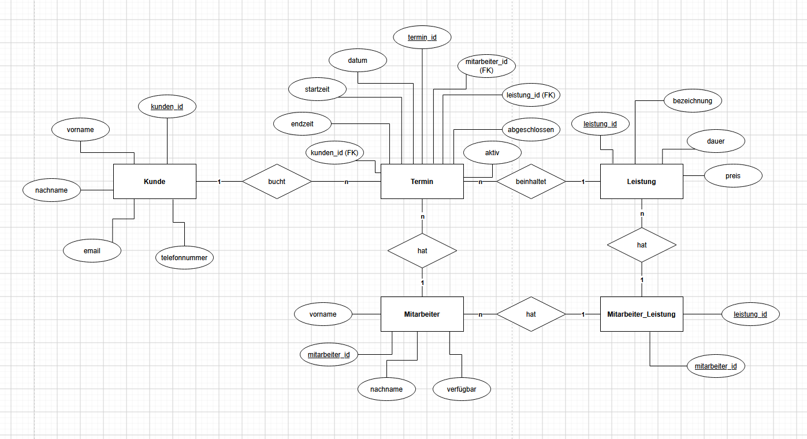

# Projektauftrag: Online-Terminbuchung für den Friseursalon Schnittpunkt
Fullstack-Anwendung, mit der Kundinnen und
Kunden online Friseurtermine buchen und die Inhaberin ihren Kalender verwaltet

## Rahmen
| Punkt | Vorgabe |
| :--- | :--- | 
| Zeitraum | 5 Arbeitstage |
| Arbeitsform | Einzelarbeit |
| Frontend | HTML, CSS und JavaScript ohne Framework, Daten per fetch |
| Backend | Node.js mit Express, REST-API |
| Datenbank | MySQL, mindestens 3 Tabellen mit Beziehungen |

Auf Basis eines Gesprächsprotokolls wurden folgende Anforderungen ermittelt:

| ID | Anforderung | Fundstelle im Protokoll | Prio |
| :--- | :--- | :--- | :--- |
| **F-01** | Kundinnen und Kunden buchen online selbst einen Termin. | „im Internet selbst einen Termin buchen“ | Muss |
| **F-02** | Bei der Buchung wählt man Leistung, Person oder „egal“, Datum und Uhrzeit. | „viele wollen zu Mara oder zu Jonas“ | Muss |
| **F-03** | Bei „egal“ wird automatisch eine freie Person zugewiesen, die die Leistung ausführen kann. | „dann nimmt die Anwendung jemanden, der frei ist“ | Muss |
| **F-04** | Kunden geben Name, Telefonnummer und E-Mail an, ein Konto ist nicht nötig. | „Name, Telefonnummer und E-Mail. Ein Konto mit Passwort will keiner“ | Muss |
| **F-05** | Bekannte Kunden werden wiedererkannt, ihre Daten bleiben gespeichert. | „nicht alles neu tippen müssen“ | Muss |
| **F-06** | Kunden können ohne Login stornieren, aber nur ihre eigenen Termine. | „Ohne Login, aber so, dass nicht jeder fremde Termine löschen kann“ | Muss |
| **F-07** | Der Salon kann jeden Termin jederzeit stornieren. | „Ich selbst muss jeden Termin jederzeit stornieren können“ | Muss |
| **F-08** | Stornierte Termine bleiben gespeichert und tragen einen Status. | „Die Termine will ich nicht löschen“ | Muss |
| **F-09** | Der Salon markiert einen Termin als erledigt. | „wenn jemand da war, hake ich das ab“ | Muss |
| **F-10** | Der Salon sieht eine Tagesübersicht mit Zeit, Leistung, Kunde und Telefonnummer, eine Spalte pro Person, und blättert zwischen Tagen. | „Ein Tag auf einen Blick“, „pro Mitarbeiter eine Spalte“ | Muss |
| **F-11** | Der Salon legt Leistungen an und ändert Preise. | „das möchte ich selbst anpassen können“ | Muss |
| **R-01** | Eine Person hat zur selben Zeit höchstens einen Termin, Doppelbuchungen sind ausgeschlossen. | „denselben Termin zweimal vergeben“, „jede Person nur einen Termin gleichzeitig“ | Muss |
| **R-02** | Die Dauer der Leistung bestimmt, wie lange die Person belegt ist. | Leistungsliste mit Minuten | Muss |
| **R-03** | Termine beginnen im 15-Minuten-Raster. | „im Viertelstundentakt“ | Muss |
| **R-04** | Ein Termin liegt komplett in den Öffnungszeiten (Di bis Fr 9 bis 18 Uhr, Sa 9 bis 14 Uhr, Mo und So geschlossen). | „Ein Termin muss komplett in die Öffnungszeit passen“ | Muss |
| **R-05** | Nur Personen, die die Leistung anbieten, sind wählbar. | „sonst bucht jemand Färben bei Jonas“ | Muss |
| **R-06** | Buchbar ist nichts in der Vergangenheit, mit mindestens 2 Stunden Vorlauf und höchstens 3 Monate im Voraus. | „Nichts in der Vergangenheit“, „mindestens zwei Stunden vorher“, „drei Monate im Voraus“ | Muss |
| **R-07** | Kunden stornieren bis 24 Stunden vorher selbst, danach nur der Salon. | „Bis 24 Stunden vorher ..., danach nur über mich“ | Muss |
| **N-01** | Der Salon-Bereich ist durch ein gemeinsames Passwort geschützt. | „ein Passwort für mich und das Team reicht“ | Muss |
| **N-02** | Die Buchungsseite zeigt keine Daten anderer Kunden, nur frei oder belegt. | „darf niemand sehen, wer sonst noch gebucht hat“ | Muss |
| **N-03** | Die Buchung ist jederzeit möglich, auch abends. | „auch abends um zehn“ | Muss |
| **W-01** | Bestätigungs-E-Mail nach der Buchung. | „Schön wäre eine Bestätigungs-E-Mail“ | Kann |
| **W-02** | Mehrere Leistungen in einem Termin, zum Beispiel Schnitt und Bart. | „Schnitt und Bart in einem Termin“ | Kann |
| **W-03** | Freie Tage pro Person. | „freie Tage pro Person wäre gut“ | Kann |
| **W-04** | Ein Instagramm-Account soll verlinkt werden | „unser Instagram-Account ist neu, den könnte man verlinken“ | Kann |


Daraus wurde folgendes ER-Modell entwickelt:


## Installierte Pakete & Setup

```bash
npm init -y
npm install express mysql2 cors dotenv cookie-parser bcrypt
npm install -D nodemon
```

**Verwendete Node.js Built-in-Module:**
- `crypto` (für die Generierung der Storno-Tokens)

**`package.json` anpassen:**
```json
{
  "type": "module",
  "scripts": {
    "dev": "nodemon server.js"
  }
}
```

### Anmerkungen:
* Angebote können nur gelöscht werden, wenn es keinen Termin dafür gibt --> ggf. später noch einbauen, dass Termine, die diese Leistung enthalten, angezeigt werden